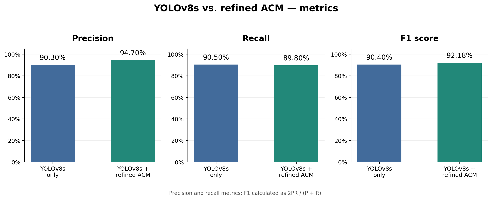
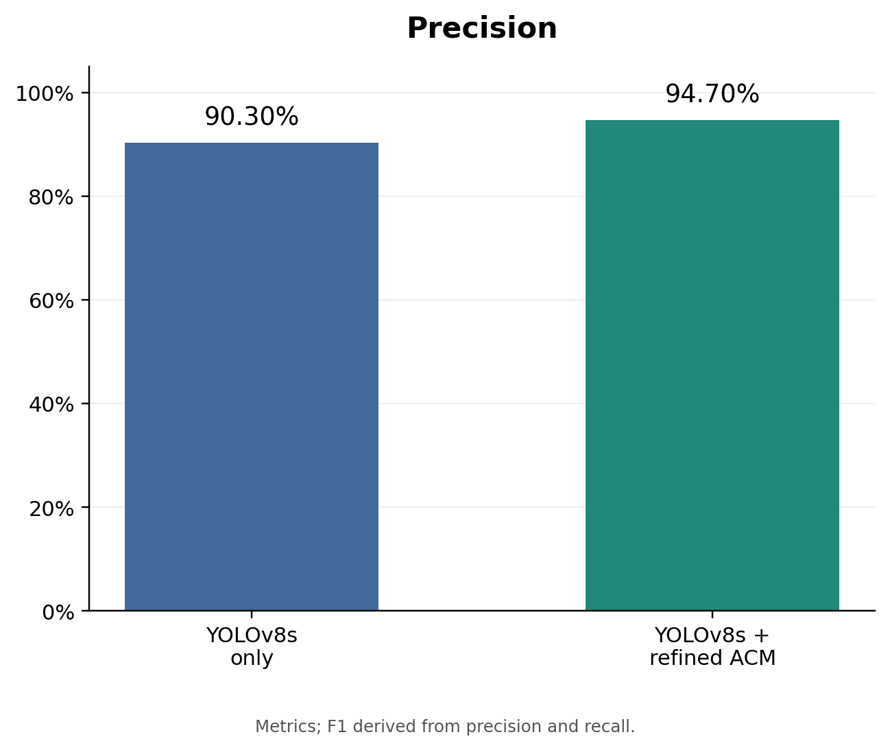
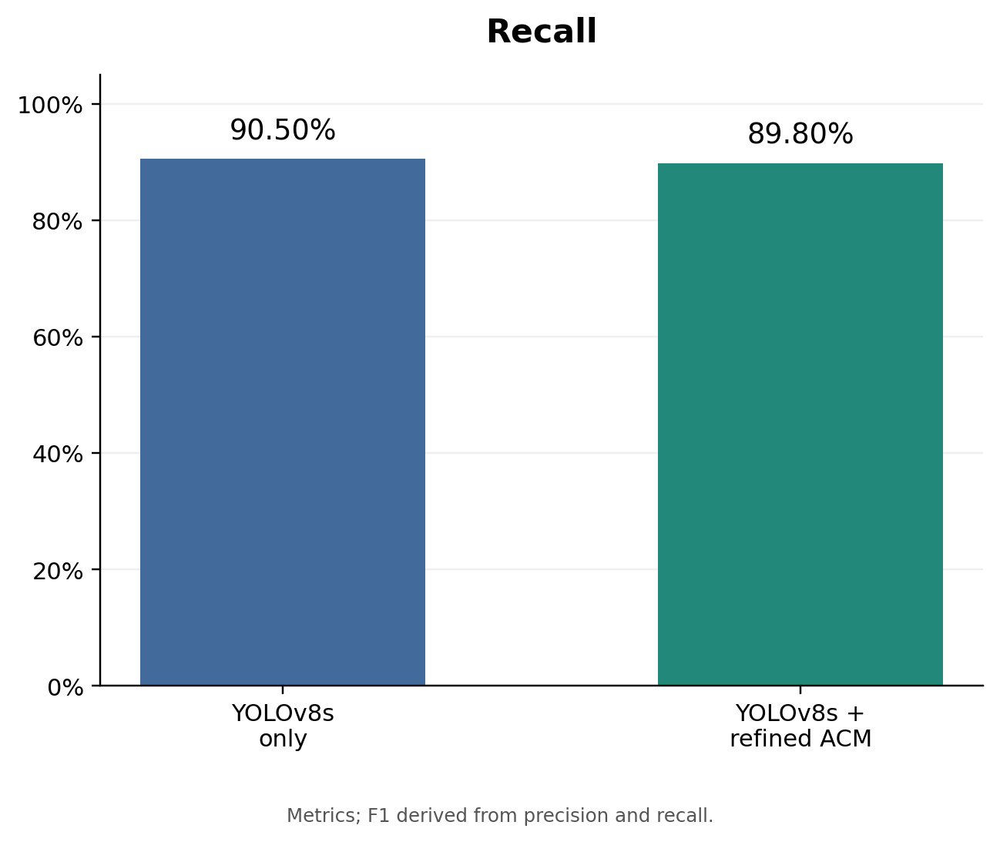
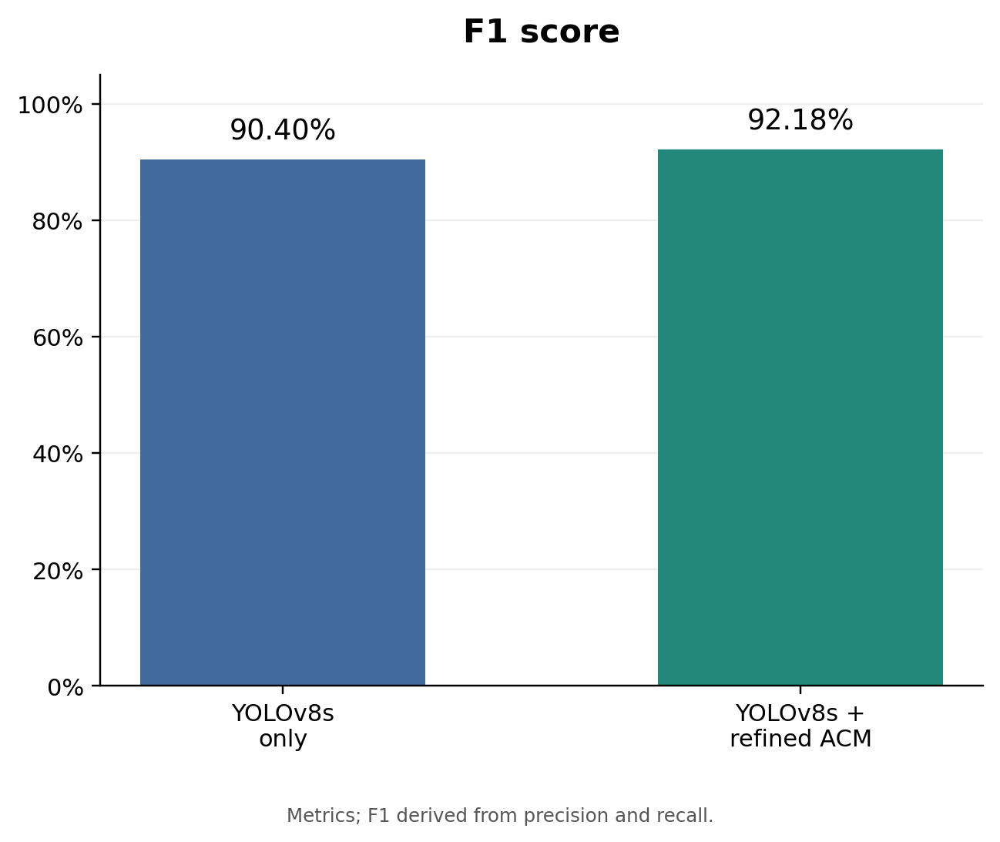
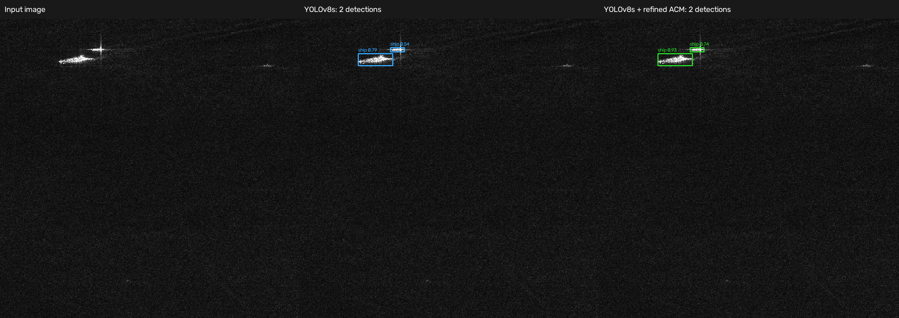
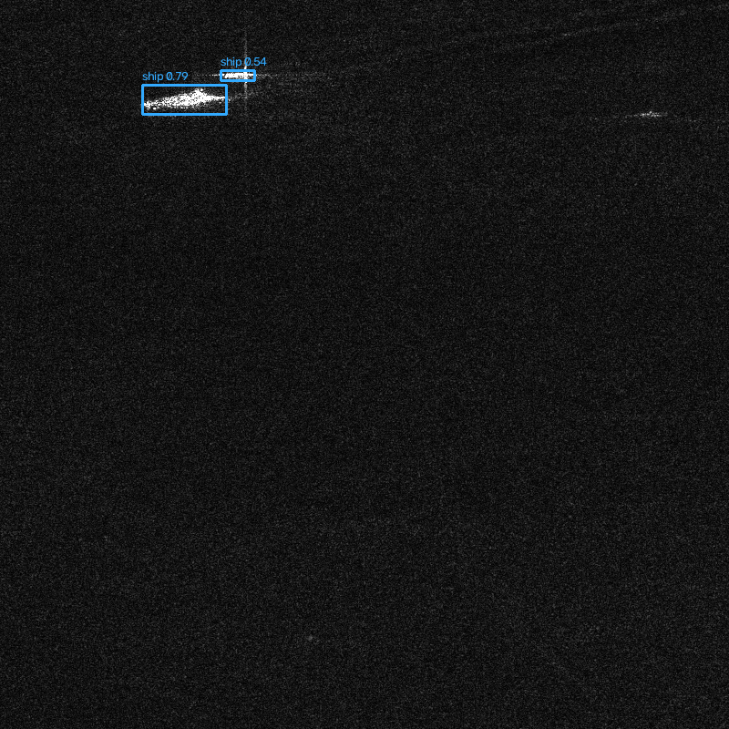
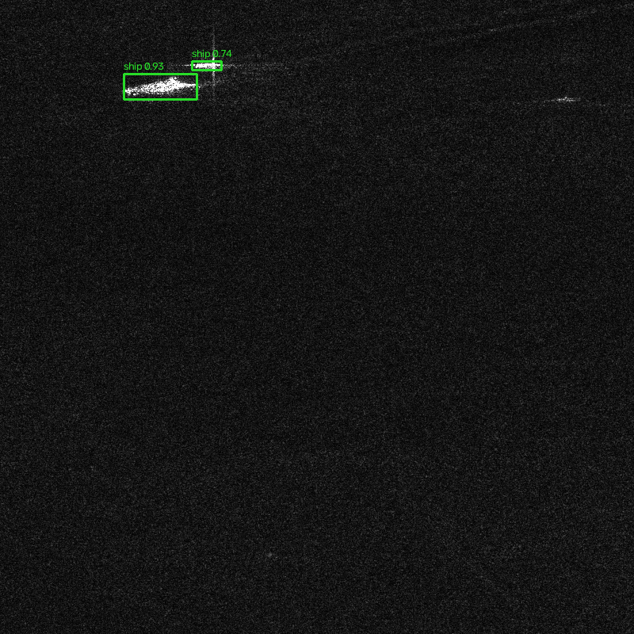

# SAR ship detection: YOLOv8s + deterministic ACM

The current version uses YOLOv8s and a validation-selected ACM calibrator with
deterministic contour smoothing.


## Metrics

The saved evaluation covers 1,962 test images and 5,922 ships at matching IoU >= 0.5.

| Method | Precision | Recall | F1 score |
|---|---:|---:|---:|
| YOLOv8s only | 90.30% | 90.50% | 90.40% |
| YOLOv8s + refined ACM | 94.70% | 89.80% | 92.18% |

precision increases by **4.40 percentage points**,
recall decreases by **0.70 points**, and F1 increases by **1.78 points**.
Generate the comparison graph locally with python eval.py.



| Precision | Recall | F1 score |
|---|---|---|
|  |  |  |

## Demo results

This example shows the input SAR image, YOLOv8s detections, and detections after
refined ACM scoring. Both methods retain two ships in this image.



| YOLOv8s | YOLOv8s + refined ACM |
|---|---|
|  |  |

See the [detection coordinates and scores](demo_results/20261013_202030_311913/detections.json).

## Predict on new images

```powershell
python predict_yolov8s_acm.py path/to/image.png
```

The source can also be an image directory. Outputs are annotated images and JSON
detections under `predicted_examples/yolov8s_acm/`. Use `--output` for a different
destination; existing predictions are not overwritten. Default artifacts:

- Detector: `useless_ahh/runs/baseline_yolov8s/weights/best.pt`
- Calibrator: `useless_ahh/evaluation_results/yolov8s_deterministic_refined/acm_calibrator.pkl`

The command checks that the detector matches the saved calibrator and requires
no ground-truth labels.

## Training and evaluation

Install dependencies with `python -m pip install -r requirements.txt`.
The Git repository contains source code, tests, documentation, the dependency
list, demo outputs, and the metric charts. Datasets, detector checkpoints,
calibrators, other evaluation results, training logs, caches, and archives stay local.

Local paths are shared through `project_paths.py`: scripts may live in
`useful_ahh/` or at the repository root. The prepared dataset belongs in
`Dataset/hrsid_yolo/`, raw HRSID data in `Dataset/hrsid/`, training runs in
`useless_ahh/runs/`, and evaluation caches in `useless_ahh/evaluation_results/`.
Pretrained weights are read from `weights/yolov8s.pt`. Metric charts are written
to `evaluation_results/yolov8_results/`, and demo outputs to `demo_results/`.
When running the local layout, prefix script names with `useful_ahh/`.

On a fresh clone, prepare the HRSID dataset with convert_hrsid.py, then train
and calibrate a detector. Predictions require a detector checkpoint and its
matching ACM calibrator; pass their paths with --model and --calibrator.
Feature rebuilding and full evaluation require locally generated caches.

Use fresh experiment names and output paths for a new GPU training run:

```powershell
python target_experiment.py --train --name baseline_yolov8s_new --output useless_ahh/evaluation_results/yolov8s_new
python refine_acm.py --source useless_ahh/evaluation_results/yolov8s_new --output useless_ahh/evaluation_results/yolov8s_new_refined
```

Defaults are CUDA GPU 0, 800-pixel images, batch size 4, and up to 100 epochs with
early stopping. Cross-split image duplicates are excluded from fitting file lists.
Calibration and threshold selection use validation images, followed by test
evaluation with frozen settings. Source scenes may still overlap across splits.

## Current files

| File or directory | Purpose |
|---|---|
| `train_baseline.py`, `target_experiment.py` | GPU training, split audit, calibration, evaluation |
| `deterministic_acm.py`, `generate_detection_analysis.py` | Contour evolution, shared detection features and matching |
| `refine_acm.py` | Validation-only search over classifiers and score blending |
| `predict_yolov8s_acm.py` | Predictions on unlabeled images |
| `summarize_yolov8s.py` | Reproduce the completed comparison report, charts, and examples |
| `rebuild_acm_features.py` | Rebuild corrected features from the original cached boxes |
| `convert_hrsid.py` | Raw HRSID to YOLO conversion |
| `test.py`, `test_deterministic_acm.py`, `test_project_paths.py` | Metric, reproducibility, and path checks |
| `project_paths.py` | Shared project paths and legacy config path resolution |
| `useless_ahh/evaluation_results/yolov8s_target/` | Local source boxes, frozen partitions, training configuration and audit |
| `useless_ahh/evaluation_results/yolov8s_deterministic/` | Local corrected feature caches and extraction provenance |
| `useless_ahh/evaluation_results/yolov8s_deterministic_refined/` | Local calibrator, frozen selection, and test results |
| `useless_ahh/evaluation_results/yolov8s_summary/` | Local final report, charts, and comparison images |
| `useless_ahh/runs/baseline_yolov8s/` | Local training records and best/last checkpoints |
| `predicted_examples/yolov8s_verified/` | Verified GPU inference example |
| `weights/yolov8s.pt` | Pretrained weights for new training runs |
| `weights/yolo26n.pt` | Ultralytics mixed-precision GPU check dependency |

Some files under `yolov8s_target` predate the smoothing correction but remain
necessary inputs for reproducing the current report and feature reconstruction.

## Verification

```powershell
python test 
python eval.py
```

License: [MIT](LICENSE).
